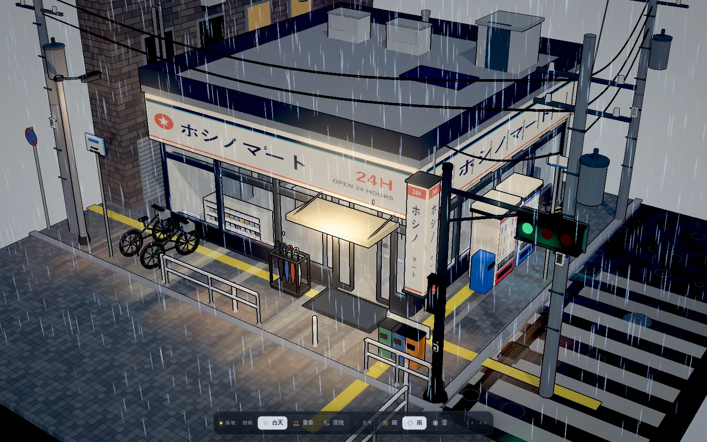
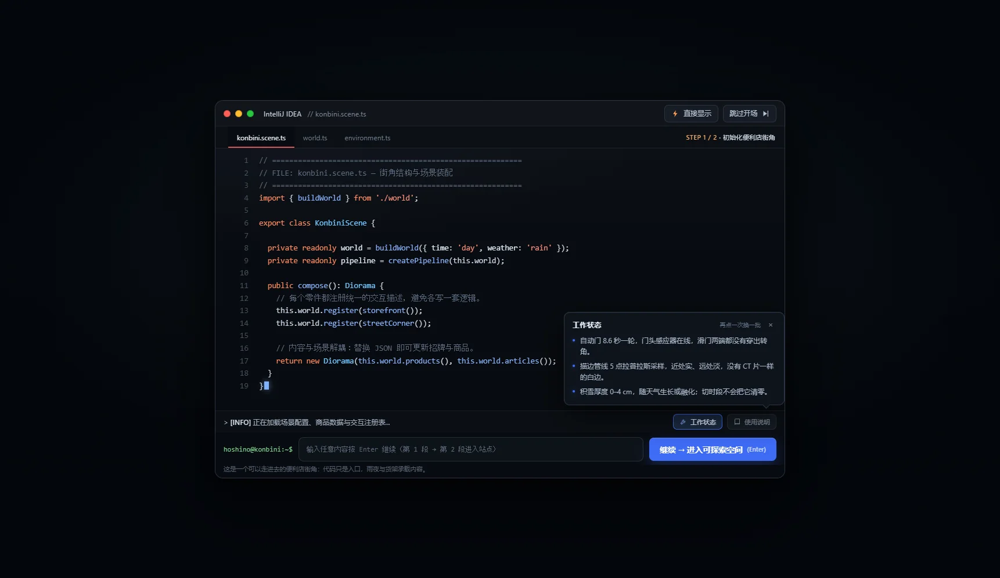
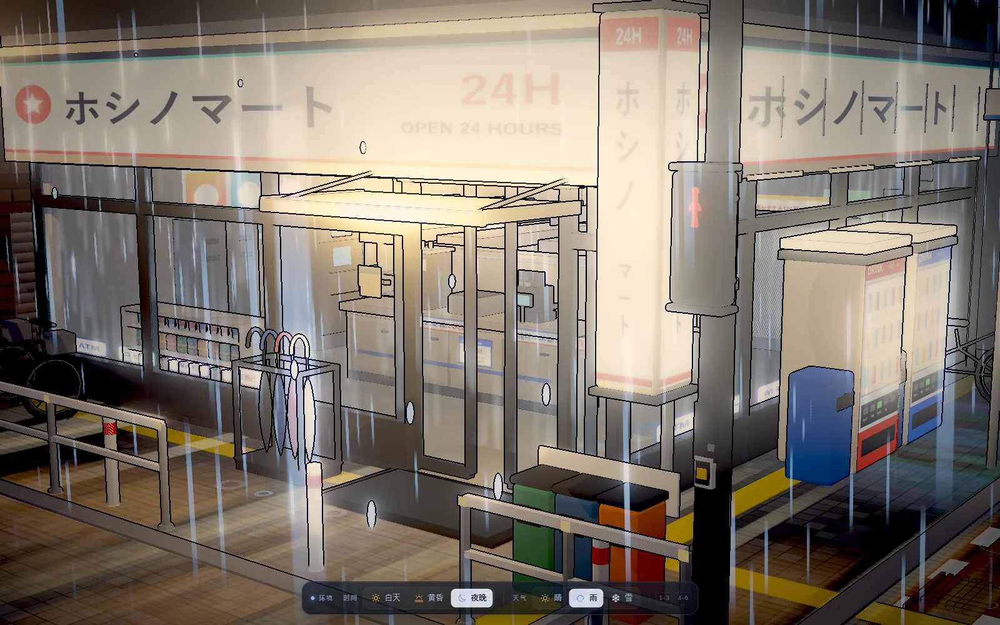
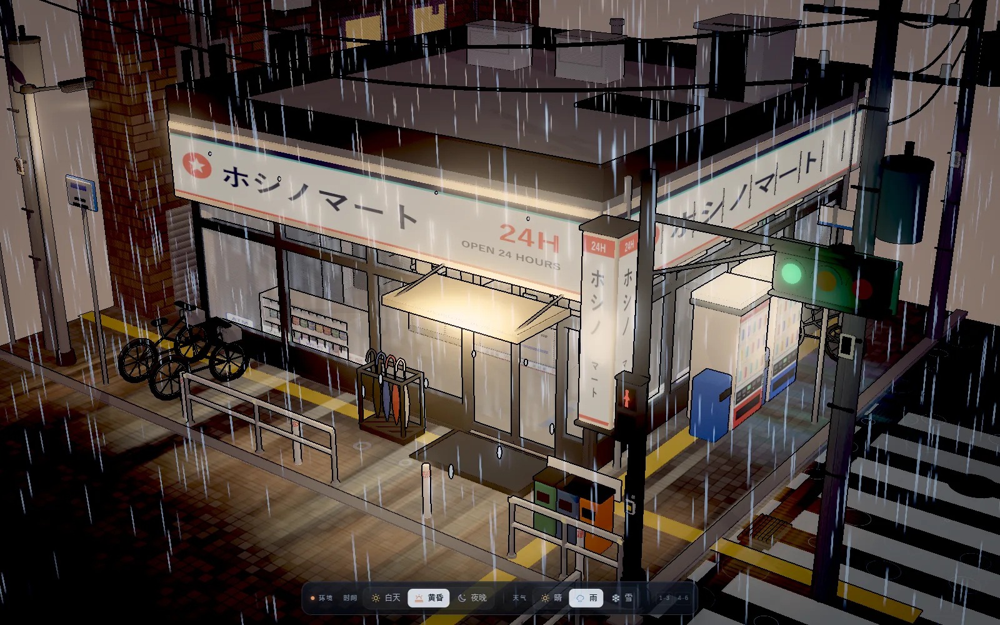
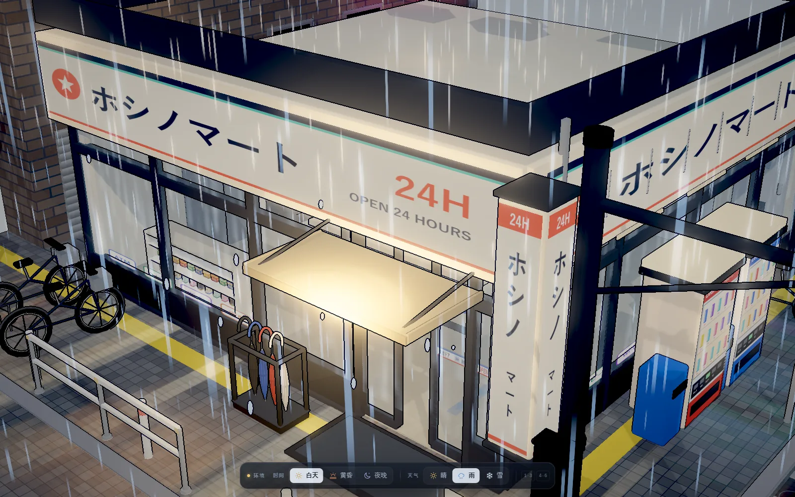

<div align="center">

# ホシノマート · 雨中便利店街角

**一个可以拖拽、旋转、缩放观看的三渲二日式便利店街角。**
没有 GLTF、没有贴图文件、页面里没有一张图片 —— 所有几何、商品包装、雨丝与招牌都在运行时用代码生成。

<p>
  
  
  
  
  
</p>



</div>

## 目录

- [为什么是它](#为什么是它)
- [快速开始](#快速开始)
- [操作](#操作)
- [开场动画](#开场动画)
- [时间与天气](#时间与天气)
- [场景里有什么](#场景里有什么)
- [三渲二是怎么画出来的](#三渲二是怎么画出来的)
- [架构](#架构)
- [调试接口](#调试接口)
- [回归验证](#回归验证)
- [部署到 GitHub Pages](#部署到-github-pages)
- [踩过的坑](#踩过的坑)
- [已知限制](#已知限制)
- [许可](#许可)

## 为什么是它

- **零资源**：模型、贴图、字体、雨、雪、招牌全部由 Canvas2D + 几何体在运行时生成。运行时不加载任何 `.glb` / 贴图 / 字体文件（README 里的截图只用于文档）。
- **一次做对两个维度**：时间（白天 / 黄昏 / 夜晚）只改光与色，天气（晴 / 雨 / 雪）只改降水与空气，9 种组合自由叠加。
- **可以走进去的密度**：747 件商品、17 组包装贴图、信号灯、自动门、贩卖机、电线杆、自行车、伞架 —— 近看能读 SKU，远看是一个完整的街角。
- **自己写的三渲二管线**：`MeshToonMaterial` + 三套色阶、深度描边、bloom、split toning、静态几何合并。
- **不是"看起来像"**：`scripts/verify.mjs` 用 59 项断言检查商品数量、开门位移、落地高度、越界、雨雪正交性、控制台同步等。

## 快速开始

需要 **Node.js ≥ 22.12**（Vite 8 的要求）。

```bash
npm install
npm run dev        # http://127.0.0.1:5188
npm run build      # 生产构建 → dist/
npm run preview    # 预览构建产物
npm run typecheck  # 类型检查
```

打开页面后先是一段 **IDE 窗口式的代码开场**：两段代码、一个标题卡、两扇门滑开。想直接看模型，加 `?instant=1`。

```bash
?time=day&weather=rain     # 白天 + 雨（默认）
?time=dusk&weather=snow    # 黄昏 + 雪
?time=night&weather=clear  # 夜晚 + 晴
?intro=0                   # 跳过代码开场，保留模型组装
?instant=1                 # 开场与组装都跳过（截图 / 调试）
```

## 操作

| 输入 | 行为 |
| --- | --- |
| 左键拖拽 | 旋转视角 |
| 滚轮 | 缩放（8–60 m） |
| 右键拖拽 | 平移 |
| 触屏单指 / 双指 | 旋转 / 缩放、平移 |
| `1` `2` `3` | 白天 / 黄昏 / 夜晚 |
| `4` `5` `6` | 晴 / 雨 / 雪 |
| `T` / `W` | 循环时段 / 循环天气 |
| `←` `→` / `↑` `↓` | 在同一分组内移动 |
| `Esc` / `Enter` | 开场期间：跳过 / 继续 |

## 开场动画

开场不是黑屏淡入，而是把"这个场景是怎么写出来的"演一遍。IDE 是一扇浮在暗背景上的窗口，不铺满屏幕：



1. **STEP 1 / 2 · 初始化便利店街角**<br>
   `konbini.scene.ts` 里逐行落下 19 行代码，底部终端写着 `hoshino@konbini:~$`。点「继续 → 进入可探索空间」或按 `Enter`。
2. **STEP 2 / 2 · 进入可探索空间**<br>
   编辑器自动滚出 `[STAGE 02]` 的 11 行 `main()`，日志从 `[INFO]` 变成 `[READY]`，按钮变成「进入站点」。
3. **标题卡**<br>
   IDE 收起，只留 `ホシノマート` 标题卡 —— **没有按钮**，停约 2.1 秒后两扇门向左右滑开，露出门后的微缩模型。

窗口左上角的红黄绿与文件标签是纯装饰；右上角的「直接显示」跳到标题卡，「跳过开场」/ `Esc` 直接进门。终端输入框里输入什么都不会被执行，按 `Enter` 与点主按钮等价。

日志条右侧的 **「工作状态」/「使用说明」也可以点**：每次从一组句子中随机抽 3 条，再点一次换一批；`Esc`、关闭按钮或点空白处收起。状态里会混入当前时段 / 天气等真实信息，帮助面板里则是这个作品的操作方式。

## 时间与天气

**时间**和**天气**是两个完全独立的维度，底部控制台把它们拆成两组分段轨道：左边时间、右边天气；切换时段不会让正在下的雨停下，切天气也不会重置积雪。

| | 晴 `clear` | 雨 `rain` | 雪 `snow` |
| --- | --- | --- | --- |
| **白天 `day`** | 清爽的城市白昼 | 主场景：雨里亮着灯 | 白天的细雪 |
| **黄昏 `dusk`** | 暖橙色的低角度光 | 湿漉漉的晚高峰 | 黄昏落雪 |
| **夜晚 `night`** | 星空 + 招牌 | 雨夜霓虹 | 雪夜漫射 |

- **时间只改**：主光 / 天光 / 补光、雾的基准、天空渐变、曝光 / 饱和 / 暗角、bloom 基准、店内与招牌亮度。
- **天气只改**：雨量、雪量、地面积水、雾的倍率与灰度、云层遮光、星空通透度。
- 雨天：3000 条实例化雨丝、屋檐滴水、玻璃雨痕、地面积水涟漪、湿地倒影；切晴后按天气淡出。
- 雪天：1800 片飘雪 + 积雪。积雪约 12 秒从 0 长到 **4 cm** 后停住，切走后约 5 秒融化；**切时段不会重置积雪**。

<p align="center">
  
  
</p>

## 场景里有什么

**便利店**
- 两条街的通高玻璃幕墙，转角无柱；招牌檐口（正面 + 侧面 + 转角竖向灯箱）
- 自动门（8.6 s 一轮）、门头感应器、地垫、带灯槽的雨棚
- 玻璃磨砂带与 ATM / コピー / Wi-Fi / 宅配 贴纸

**店内**（隔着玻璃可见）
- 五层饮料冷柜、零食 / 杯面墙架、饭团便当冷藏柜、后场门
- 杂志架、ATM、储物架；三排双面货架 + 面向玻璃的开放矮货架
- 收银台：分块柜门、拉手、踢脚散热口、咖啡菜单板、收银机、顾客显示屏、关东煮（8 种串）、咖啡机、热食柜、背柜香烟陈列、柜台灯箱

**街道**
- 自动贩卖机 ×2、路灯、电线杆 ×4 + 悬垂电线、街角信号灯（车灯 10s 绿 / 3s 黄 / 13s 红，行人与车灯互锁）
- 自行车 ×3、黑框四伞伞架、分类垃圾桶、反光柱、护栏、禁止停车牌、街名牌
- 斑马线、停止线、车道线、止まれ、井盖、排水篦子、导盲砖
- 左侧砖砌邻楼与带霓虹的小巷

**动效**
- 3000 条雨丝（1 个 draw call，靠近暖光区被染成金色）、屋檐滴水、三层玻璃雨痕、积水波纹
- 招牌 / 路灯 / 霓虹呼吸与接触不良闪烁、湿地暖光倒影
- 模型入场时按层组装：底座 → 铺装 → 外壳 → 内装 → 屋顶 → 街道 → 道具 → 亮灯

<p align="center">
  
</p>

## 三渲二是怎么画出来的

**色阶**：核心是 `MeshToonMaterial` + 色阶渐变贴图，三套分工：

| 色阶 | 档数 | 用途 | 为什么 |
| --- | --- | --- | --- |
| `RAMP_MAIN` | 4 | 默认 | 硬边色阶，赛璐璐的骨架 |
| `RAMP_SMOOTH` | 12 | 地面、人行道 | 4 档在平地上会切出同心圆，像渲染 bug |
| `RAMP_INDOOR` | 6 | 店内一切 | 上限压低避免死白，下限抬高才能隔着玻璃看清货架 |

**轮廓**：自建后处理做 5 点拉普拉斯深度边缘检测，近 / 远距离淡出；不用 `OutlineEffect`，因为它会替换材质，和 `InstancedMesh`、自定义 `ShaderMaterial` 冲突。

**后处理顺序**：场景（含深度纹理）→ bloom → 描边 + split toning + 暗角 + sRGB → 屏幕。

**静态合并**：入场结束后把静态 `MeshToonMaterial` 合并，draw call 从 ~1780 降到 **~830**（约 28.7 万三角面）；`InstancedMesh`、发光体、玻璃、雨雪和 `auto-door` 子树不参与。

**商品**：每件商品不是纯色方块，而是 17 组 Canvas 包装贴图 + `InstancedMesh`（薯片 / 盒装 / 罐装 / 瓶装 / 杯面），747 件商品只有 17 组 draw call 级别的开销。

## 架构

```
src/
├── core/
│   ├── palette.ts      调色板（改配色只动这里）
│   ├── textures.ts     Canvas2D 程序化贴图
│   ├── snowTex.ts      积雪表面噪点
│   ├── materials.ts    三渲二材质 + 三套色阶 + 光晕
│   ├── geom.ts         几何工厂（圆角盒 / 圆柱 / 斜面 / 电线 / UV 平铺）
│   └── products.ts     商品包装：Canvas 贴图 + InstancedMesh（747 件 → 17 组）
├── scene/
│   ├── layout.ts       总平面 —— 全项目唯一的尺寸来源
│   ├── base.ts         底座 / 沥青 / 人行道 / 标线 / 湿地反光 / 涟漪
│   ├── store.ts        建筑外壳 / 玻璃幕墙 / 招牌 / 雨棚 / 自动门 / 屋面
│   ├── interior.ts     店内陈设
│   ├── street.ts       街道家具 / 电线杆 / 小巷 / 邻楼
│   ├── signal.ts       信号灯（车灯 + 行人灯 + 互锁循环 + 地面反光）
│   ├── rain.ts         雨丝 / 滴水 / 玻璃雨痕 / 体积光锥
│   ├── snow.ts         积雪薄板（生长 + 硬上限）
│   ├── snowfall.ts     飘雪粒子
│   ├── stars.ts        星空 + 天空渐变
│   ├── wet.ts          湿地反光 / 积水暗斑 / 涟漪的统一淡入淡出
│   ├── environment.ts  时段 × 天气的正交合成
│   ├── assembly.ts     分层入场动画
│   ├── merge.ts        静态几何合并
│   └── world.ts        组装 + 主更新
├── render/
│   ├── camera.ts       OrbitControls + 竖屏自动退远
│   └── pipeline.ts     深度描边 + bloom + 调色
├── ui/
│   ├── envbar.ts       底部时间 / 天气控制台
│   └── intro.ts        IDE 式代码开场（两段 → 标题卡 → 滑门）
└── main.ts             入口
```

**只有 `layout.ts` 一个尺寸来源**：任何模块都不硬编码店面宽度、门洞位置、人行道高度；改一个数字，所有构件跟着走。

## 调试接口

浏览器控制台可用 `window.__konbini`：

```js
__konbini.skipIntro()                                  // 跳过开场 + 模型组装
__konbini.skipOpening()                                // 只跳过开场，保留组装
__konbini.view([11, 11.2, 15.2], [-0.8, 0.8, -1.2])    // 相机位
__konbini.spin(true)                                   // 自动旋转
__konbini.stats()                                      // draw call / 三角面 / 显存
__konbini.pipeline.debugEdges(true)                    // 只看描边（调参用）
__konbini.layout                                       // 总平面常量
__konbini.env.get() / set() / cycleTime() / getSnow() / details()
__konbini.signal.state()                                // 当前车灯 / 行人灯相位
__konbini.world.setMergeEnabled(false)                 // 关掉静态合并（调试单件）
```

## 回归验证

`scripts/verify.mjs` 是场景的自动判定脚本（**59 项断言**）：

```bash
npm run build
npx vite preview --port 5188
node scripts/verify.mjs http://127.0.0.1:5188/
```

覆盖：入场动画分阶段推进、商品数量与包装贴图、关键构件存在性、自动门实际位移、
**开门后门洞底部没有静止的「门槛」构件**、**门洞里没有多余的静止竖挺**、
draw call / 三角面上限、静态合并生效、店内不穿模、收银台位置合法、门扇不穿出转角、
**3 时段 × 3 天气共 9 组都能切换且雨 / 雪 / 湿度 / 星空只由对应维度决定**、
雨棚不越界、**自行车与电线杆精确落地**、**街道物件不越出台座**、
**积雪逐步变厚且封顶停住**、**下雪有飘雪粒子**、**柜台设备都在台面内**、
**人行道顶面 = 路缘 0.14**、**竖招牌抬高并移出檐口**、**伞架为黑框四伞**、
**中央货架右移且左侧通道 ≥ 0.70 m**、**开放矮货架不把商品封进盒体**、
**静态合并后热食柜柜体仍在**、**自行车坐垫与座管相连**、**货架顶部分类牌不悬空**、
**自行车不陷进侧墙**、**蓝色回收桶在售卖机外侧**、**垃圾桶背后没有护栏白条**，
以及无 JS 运行时错误。

专项脚本：

| 脚本 | 断言数 | 覆盖 |
| --- | --- | --- |
| `node scripts/check-ui.mjs` | 23 | 分组 / 图标 / 点击与键盘 / 双向同步 / 手机双行 / aria |
| `node scripts/check-env.mjs` | 10 | 9 组矩阵、切时段不断雨雪、积雪跨时段继续长、湿地淡入淡出 |
| `node scripts/check-signal.mjs` | 15 | 信号灯落地 / 不挡店 / 行人灯挂杆 / 三相位 / 互锁 / 走路帧 |
| `node scripts/check-snow.mjs` | — | 积雪生长、封顶、融化、飘雪粒子 |

截图脚本：`node scripts/shoot.mjs`（9 个固定视角）、`node scripts/shots-env.mjs`（时段 × 天气矩阵）、`node scripts/shots-fix.mjs`（穿模 / 收银台 / 门的定点视角）。

## 部署到 GitHub Pages

仓库自带 `.github/workflows/deploy.yml`，把 **`konbini-diorama/` 作为仓库根目录** 推上 GitHub 即可：

1. 创建空仓库，不要勾选 README / .gitignore / license。
2. `git init && git add . && git commit -m "feat: konbini diorama" && git branch -M main`，然后 push。
3. 仓库 **Settings → Pages → Source** 选择 **GitHub Actions**。

之后每次 push 到 `main` 都会自动构建并部署，地址形如 `https://<用户名>.github.io/<仓库名>/`。Vite 已经设置 `base: './'`，项目页与用户主页都能直接加载，资源不会 404。

## 踩过的坑

<details>
<summary>点开看 15 条踩坑记录（含这次的"多出来的门框"）</summary>

- **点光阴影会在人行道上糊出一块椭圆。** 点光源阴影是 6 面立方体贴图，bias 稍有不合适就在大平面上糊出深色区域。现在门灯不开阴影，投影交给方向光。
- **圆形衰减贴在长条平面上，四角会露出弧线。** 招牌光晕必须按宽高比生成椭圆衰减（切比雪夫半径），尺寸也不能比招牌大太多，否则会在招牌上方画出"穹顶"。
- **自动门的原点必须在门洞中心。** 旧版 `doorRoot` 建在 x=0，门洞中心在 x=0.95，两扇门整体偏左，滑开时滑出门洞，看起来就是"门打不开"。
- **纯玻璃门看不出开合。** 每扇门玻璃上贴一条横向店铺信息带（`doorStickerTex`），开门才有可读变化。
- **滑门不能有横穿门洞的静止构件。** 踢脚板、磨砂膜、中横梁、下沿收边原来都是通长，门一开就像门口卡着一块不会动的板。现在都走 `frontGaps()` 在门洞处断开。
- **均分竖挺会正好落进门洞里。** 立面竖挺按 `round(span / 2.0)` 均分，前脸 7.6 m 分出 `-3.5 / -1.6 / 0.3`，0.30 正好在门洞 `0.15..1.75` 内部。门一开就变成"多出来的一个门框"。现在门洞内只保留两侧门边挺，并加了自动断言。
- **「时段」和「天气」不能共享同一批字段。** 旧版把 `rainDensity` 写进时段预设，于是"白天 + 雨"算出来的雨量是 0。现在 `environment.ts` 拆成 `TIME` 与 `WEATHER` 两层，`compose()` 纯函数合成 9 种组合。
- **人行道挤出的高度不能 translate 两次。** `ExtrudeGeometry(depth=L.curb)` 旋转后已经在 `0..0.14`，再抬一次会把顶面推到 0.28，自行车、垃圾桶、信号灯全陷进路面。
- **招牌箱体和贴图必须共心。** `addBox` 的 y 是底边，face plane 的原点在几何中心；写错 1.25 m，贴图下半截就会悬在玻璃前。
- **货架不能是"实心盒子 + 藏在里面的商品"。** 现在只保留底座、侧板、背板、顶板，正面敞开，薯片和杯面直接对着玻璃。
- **圆杆不能直接 `lookAt`。** `Object3D.lookAt` 把 local +Z 对准目标，而 `CylinderGeometry` 的长轴是 local +Y。用 `setFromUnitVectors((0,1,0), dir)` 才真正对齐。
- **台面设备要从"总长"反推。** 四件设备间距 0.78 / 0.72 / 0.68 合计 2.92 m，台面只有 2.4 m，最左边热食柜就会悬空。每件单独看都合理，只有算总和才暴露。
- **有轮子的东西不能靠手算高度。** 自行车轮心 0.33、轮胎半径 0.346，算错 1.6 cm 就陷进地砖。构建完用世界包围盒量真实最低点再抬起来。
- **动态网格要排除静态合并。** 积雪用 `MeshToonMaterial`，会被 `mergeStaticMeshes` 摘走，`snow-layer.children.length` 变成 0，动画完全失效。
- **新建网格要立刻初始化到零状态。** 积雪薄板几何原始高度是 1 m，不在创建时 `apply(0)`，第一次 `update()` 之前它就是满厚度 —— 雨天屋顶也是白的。

</details>

## 已知限制

- **玻璃不做真实折射**，只是低不透明度 + 雨痕叠加。三渲二不需要折射，要的是"一眼看透店内"。
- **湿地反射是画上去的**加色贴图，不是实时平面反射；更接近动画背景美术，也更便宜。
- **静态合并后单件不可编辑**。需要单独调某个零件时，把它的 `name` 加进 `mergeStaticMeshes` 的 `excludeNames`。
- **晴天不会有"实心阴影"**：三渲二的阴影只是压暗一个色阶，晴天阳光的强投影感会偏弱。
- **首帧可能有 200–400 ms 着色器编译停顿**，低端设备上更明显。
- **UI 只有底部一块控制台**，没有加载页、没有设置面板；竖屏首屏会按宽高比自动退远。

## 许可

MIT

<div align="center">
<sub>Built with Three.js · TypeScript · Vite — 所有风景都是代码。</sub>
</div>
