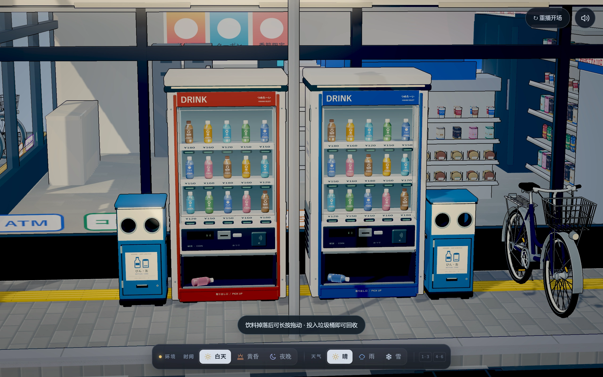

# ホシノマート · 日式便利店街角

一个可以在浏览器里探索的日式便利店微缩场景。玻璃门后摆着饭团、便当和一排排货架，门外有伞架、自行车和交替亮起的信号灯。模型和贴图都由代码生成，三渲二的光影让街角看起来像一幅立体漫画。

**[在线体验](https://joker0-hub.github.io/konbini-diorama/)** · [直接看雨夜](https://joker0-hub.github.io/konbini-diorama/?time=night&weather=rain&instant=1)


## 探索街角

- 用鼠标**旋转、缩放和平移视角**，分别对应左键拖动、滚轮和右键拖动。触屏上单指旋转，双指缩放和平移。可以贴近玻璃看店内陈列，也能绕到侧街找售卖机。
- 在底部**切换时段和天气**。白天、黄昏、夜晚可以与晴、雨、雪自由搭配，共有九种组合。雨天有屋檐滴水、路面积水和涟漪，雪天会逐渐积雪，切回晴天后慢慢融化。键盘 `1`–`3` 切换时段，`4`–`6` 切换天气。
- 点击**樱花树**可以调整花簇的疏密和落樱的强度。
- 风雨、鸟鸣和虫鸣随环境变化，购买、碰撞和回收也有音效。右上角的**声音面板**可以分别调节环境音、交互音效和背景音乐，也能播放本地音频。
- **开场动画**先演示代码，再从底座开始逐层组装街角。可跳过开场，也可以从右上角重播。
- 点击右上角的**镜头归位**，可从旋转、缩放或商品近景平滑回到初始全景；手机竖屏会使用适合屏幕的视角。

## 自动售卖机

店侧的两台售卖机各提供六种饮料，可以模拟购买清香绿茶、波子汽水、白桃果饮等。

1. **点击售卖机**，镜头会拉近并打开饮品菜单。选好后，饮料会掉进下方取货口。
2. **长按瓶身并拖动**，松手可以放下或抛出。落在地上的瓶子约 10 秒后会被清理，期间可以再次拾起。
3. 把瓶子**拖到回收桶**上，出现回收提示后松手即可回收。



## 本地运行

需要 Node.js 22.12 或更新版本，以及支持 WebGL 2 的浏览器。

```bash
git clone https://github.com/joker0-hub/konbini-diorama.git
cd konbini-diorama
npm ci
npm run dev
```

打开终端显示的地址，默认是 `http://127.0.0.1:5188/`。运行 `npm run build` 可生成生产构建。

## 许可

项目声明使用 MIT 许可；仓库目前尚未附独立的 `LICENSE` 文件。

<div align="center">
<sub>Built with Three.js · TypeScript · Vite · cannon-es — 所有风景都是代码。</sub>
</div>
