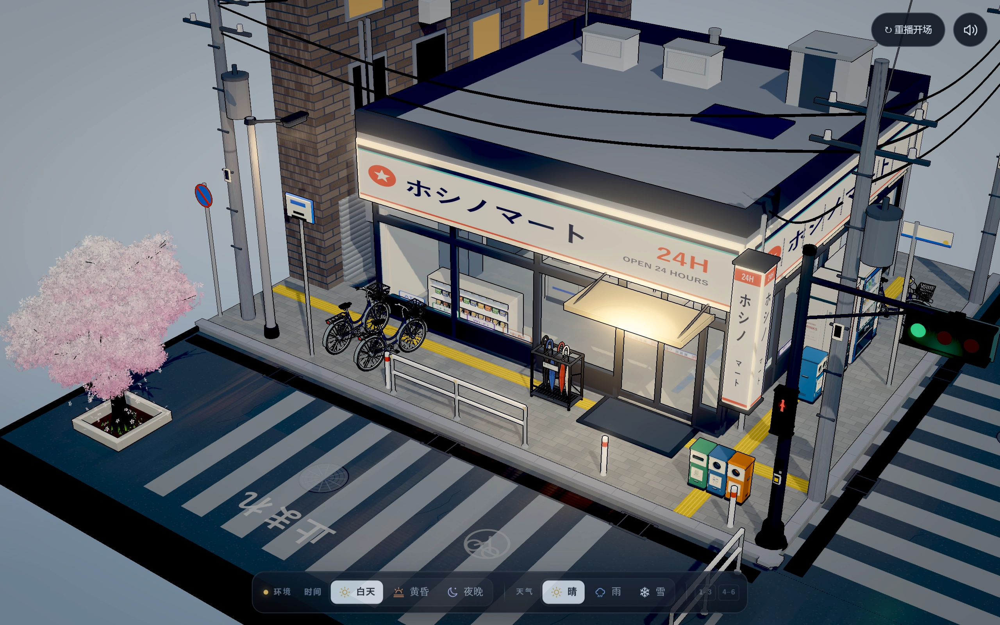
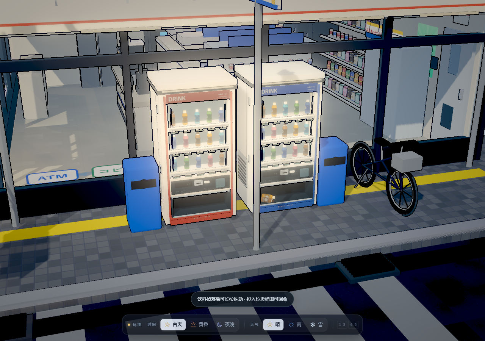
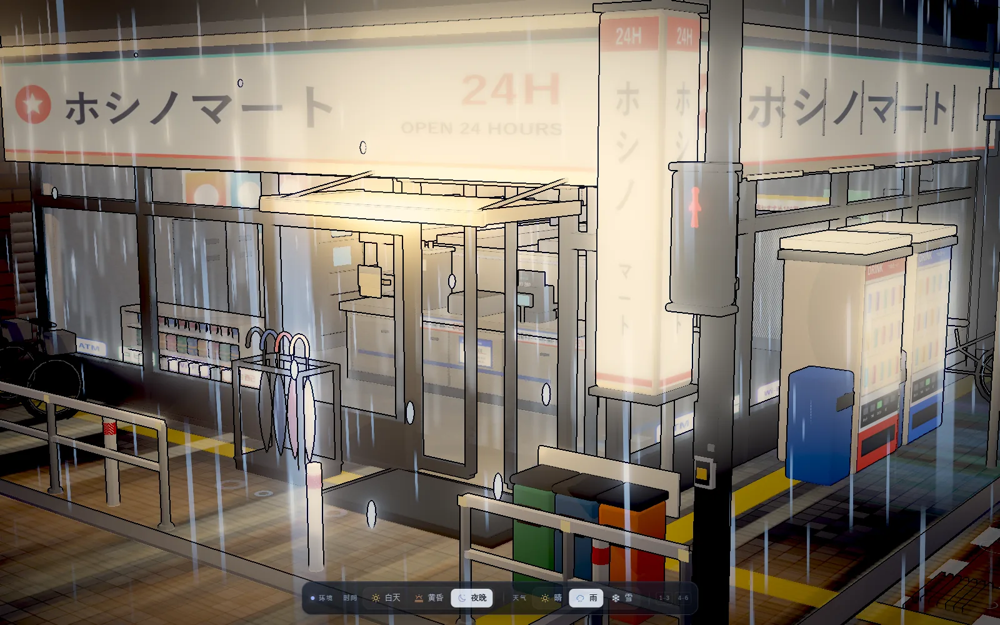
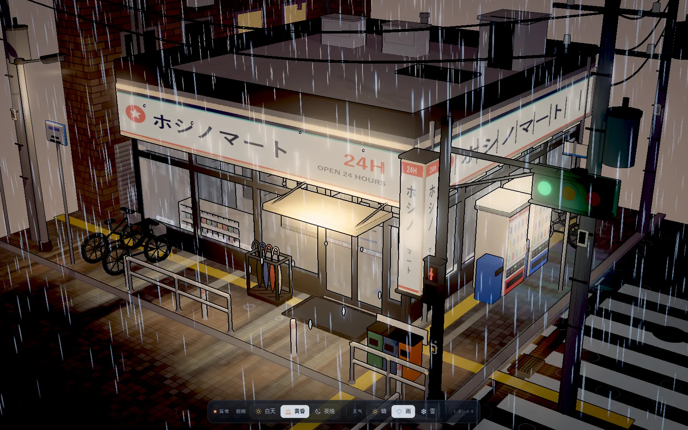
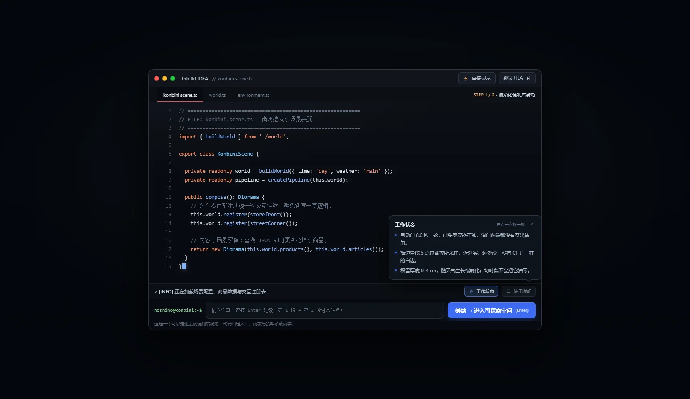
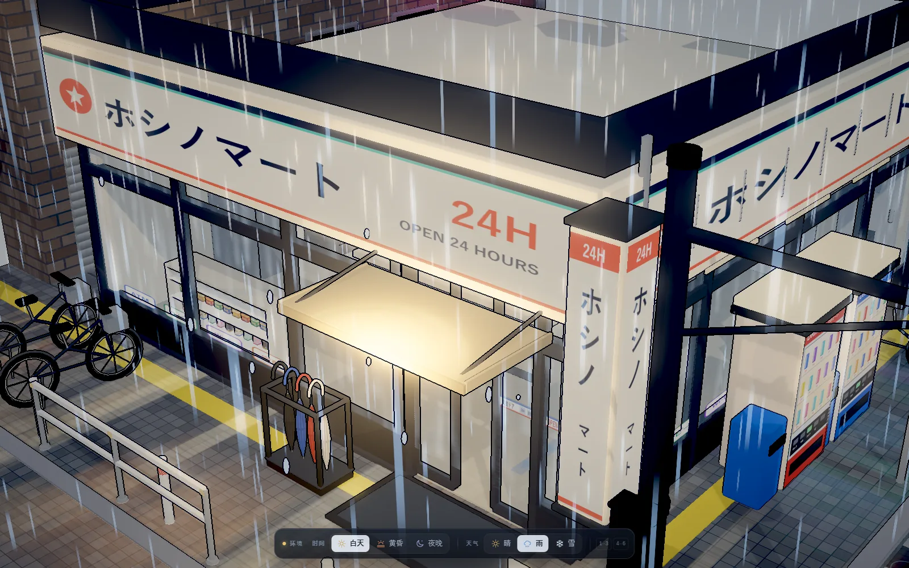

<div align="center">

# ホシノマート · 日式便利店街角

**用代码搭建的一座三渲二微缩街角。**

在雨夜看招牌亮起，在雪天等屋顶积雪；转到售卖机前买一瓶饮料，再把它拖进回收桶。

<p>
  <a href="https://joker0-hub.github.io/konbini-diorama/">在线体验</a> ·
  <a href="#快速开始">本地运行</a> ·
  <a href="#操作指南">操作指南</a> ·
  <a href="#开发与验证">开发与验证</a>
</p>

<p>
  
  
  
  
  <a href="https://github.com/joker0-hub/konbini-diorama/actions/workflows/deploy.yml"></a>
</p>



</div>

## 项目亮点

- **程序化场景**：建筑、商品包装、招牌、雨雪与樱花由几何体、Canvas2D 和着色器生成，无需外部 GLTF 模型、贴图或字体文件；文档截图不参与运行。
- **时段 × 天气**：白天、黄昏、夜晚与晴、雨、雪自由组合，光照和天气独立过渡，切换时段不会重置积雪。
- **可交互售卖机**：两台售卖机、六种饮品、购买面板、物理掉落、长按拖拽、抛落与垃圾桶回收。
- **街角细节**：自动门、室内货架与收银台、互锁交通信号灯、自行车、伞架、霓虹小巷，以及可调整花冠和落樱的樱花树。
- **三渲二渲染**：分层色阶、深度描边、bloom 与调色，结合实例化和静态几何合并控制渲染开销。
- **可验证的交互**：提供场景、天气、信号灯、售卖机物理与浏览器手势回归脚本。

## 快速开始

需要 **Node.js ≥ 22.12** 和 npm。浏览器需支持 WebGL。

```bash
git clone https://github.com/joker0-hub/konbini-diorama.git
cd konbini-diorama
npm ci
npm run dev
```

打开终端显示的本地地址，默认是 **http://127.0.0.1:5188/**。端口被占用时以 Vite 实际输出为准。

首次进入会播放 IDE 式代码开场，再展示模型组装。想直接探索，可打开：

```text
http://127.0.0.1:5188/?instant=1
```

| 命令 | 用途 |
| --- | --- |
| `npm run dev` | 启动开发服务器 |
| `npm run typecheck` | TypeScript 类型检查 |
| `npm run build` | 生成生产资源到 `dist/` |
| `npm run preview` | 本地预览生产构建，需先执行 build |

## 操作指南

| 输入 | 行为 |
| --- | --- |
| 鼠标左键拖拽 | 旋转视角 |
| 滚轮 / 右键拖拽 | 缩放 / 平移 |
| 触屏单指 / 双指 | 旋转 / 缩放与平移 |
| 点击售卖机 | 打开饮品选择面板 |
| 点击饮品 | 模拟购买，在取货口生成饮料 |
| 长按饮料，再拖动 | 拾起饮料；松手放下或抛落 |
| 将饮料拖到垃圾桶后松手 | 立即回收 |
| 点击樱花树 | 调整花簇蓬松度、纵深、疏花程度与落樱强度 |
| `1` / `2` / `3` | 白天 / 黄昏 / 夜晚 |
| `4` / `5` / `6` | 晴 / 雨 / 雪 |
| `T` / `W` | 循环切换时段 / 天气 |
| 方向键 | 在聚焦的时间或天气分组内切换 |
| `Enter` / `Esc` | 开场期间继续 / 跳过；饮品面板内 `Esc` 关闭 |

### 售卖机与饮料

先旋转到能看见售卖机正面的位置，待模型组装完成后点击机器。选择饮品后，饮料会掉进下方取货口；长按约 **0.36 秒**即可拾起，拖动时暂停镜头控制。

| 饮品 | 场景内标价（日元） |
| --- | ---: |
| 山泉水 | ¥120 |
| 清香绿茶 | ¥150 |
| 波子汽水 | ¥150 |
| 白桃果饮 | ¥160 |
| 牛乳咖啡 | ¥180 |
| 鲜橙果汁 | ¥160 |

这是纯前端互动演示，不接入真实支付。每台机器的取货口最多保留 **3 瓶**，购买第 4 瓶会移除最早的一瓶。放下的饮料进入 **10 秒**清理倒计时，期间可再次拾起；投入垃圾桶会立即回收。



## 时间与天气

默认组合为 **白天 + 雨**。底部控制台分别控制时间和天气，也可通过 URL 指定初始状态。

| 时段 | 晴 `clear` | 雨 `rain` | 雪 `snow` |
| --- | --- | --- | --- |
| 白天 `day` | 明亮街角 | 雨中便利店 | 白昼细雪 |
| 黄昏 `dusk` | 暖橙光照 | 湿地晚霞 | 暮色落雪 |
| 夜晚 `night` | 星空与招牌 | 雨夜霓虹 | 雪夜灯光 |

- 时间控制光照、天空、曝光和店铺亮度；天气控制降水、湿地、云雾与星空通透度。
- 雨天包含雨丝、屋檐滴水、玻璃雨痕、积水涟漪和风格化湿地反光。
- 雪天包含飘雪与逐步增长的积雪；天气切走后积雪融化，切换时段则保留积雪进度。

<p align="center">
  
  
</p>

| URL 参数 | 作用 |
| --- | --- |
| `?time=day&weather=rain` | 白天 + 雨，默认组合 |
| `?time=dusk&weather=snow` | 黄昏 + 雪 |
| `?time=night&weather=clear` | 夜晚 + 晴 |
| `?intro=0` | 跳过代码开场，保留模型组装 |
| `?instant=1` | 跳过开场和组装，环境过渡直接到位，便于调试与截图 |

参数可以组合，例如 `?time=night&weather=rain&instant=1`。

## 开场与场景

IDE 式开场分为两段代码演示、标题卡和滑门揭幕，随后模型按底座、铺装、建筑、内装和街道道具逐层组装。开场终端仅用于演示，输入不会作为命令执行。

<details>
<summary>查看开场与店面近景</summary>




</details>

建筑包含玻璃幕墙、转角灯箱、雨棚与自动门。店内陈列饮料冷柜、零食杯面货架、饭团便当柜、杂志架、ATM，以及收银台上的咖啡机、关东煮和热食柜。街道还包括车行与人行信号灯、悬垂电线、导盲砖、斑马线、井盖和排水篦子。

## 技术与结构

**技术栈：** Three.js · TypeScript · Vite · cannon-es · Puppeteer Core。

渲染采用 `MeshToonMaterial`，为主体、地面和室内分别设置色阶。场景先输出颜色与深度，再叠加 bloom、深度边缘描边、调色与暗角。重复商品使用 `InstancedMesh`，静态模型在组装完成后合并；自动门、售卖机饮料等动态对象独立更新。

```text
src/
├── main.ts                  场景启动、事件协调、调试接口
├── core/
│   ├── palette.ts           调色板
│   ├── geom.ts              几何工厂
│   ├── materials.ts         三渲二材质与色阶
│   ├── textures.ts          Canvas2D 程序化贴图
│   ├── products.ts          店内商品与实例化包装
│   ├── vending-products.ts  售卖机共享饮品目录
│   └── bottle-physics.ts    cannon-es 刚体、碰撞与回收区域
├── scene/
│   ├── layout.ts            场景布局与共享尺寸
│   ├── world.ts             场景模块装配
│   ├── store.ts             建筑外壳与自动门
│   ├── interior.ts          店内陈设
│   ├── street.ts            街道家具与道具
│   ├── vending.ts           售卖机模型、出货与饮料生命周期
│   ├── sakura.ts            樱花树、花瓣与参数更新
│   ├── environment.ts       时间与天气状态
│   └── ...                  雨雪、信号灯、组装与静态合并
├── render/                  相机控制与后处理管线
└── ui/                      开场、环境栏、樱花面板、购买与拖拽交互
scripts/                     自动验证与截图
.github/workflows/deploy.yml GitHub Pages 构建部署
```

### 调试接口

页面加载后，在浏览器控制台使用 `window.__konbini`：

```js
const k = window.__konbini;
k.skipIntro();                                  // 跳过开场和模型组装
k.skipOpening();                                // 只跳过开场
k.view([11, 11.2, 15.2], [-0.8, 0.8, -1.2]);    // 设置相机与观察目标
k.spin(true);                                   // 自动旋转
k.env.set({ time: 'night', weather: 'rain' });    // 切换环境
k.env.get();                                    // 当前时段与天气
k.env.getSnow();                                // 积雪量
k.signal.state();                               // 车灯与行人灯状态
k.stats();                                      // 绘制调用、三角面与资源数量
k.pipeline.debugEdges(true);                    // 查看深度描边
k.world.setMergeEnabled(false);                 // 调试时关闭静态合并
```

## 开发与验证

先运行不依赖浏览器的检查：

```bash
npm run typecheck
npm run build
npm run check:vending
```

`check:vending` 检查售卖机几何、刚体、出货数量、拖拽状态、碰撞、回收与清理逻辑。脚本为创建程序化贴图提供 Canvas2D 桩，不验证视觉渲染。

浏览器回归需要本机安装 Chrome，以及一个正在运行的开发或预览服务器：

```bash
# 终端一：预览刚生成的生产构建
npm run preview

# 终端二：运行浏览器检查
npm run verify
npm run check:ui
npm run check:env
npm run check:signal
npm run check:vending-ui
```

| 检查 | 覆盖范围 |
| --- | --- |
| `verify` | 入场、场景构件、商品、自动门、布局与环境组合 |
| `check:ui` | 环境栏点击、键盘、状态同步、移动端布局与可访问性 |
| `check:env` | 九组环境组合、切换连续性、积雪与湿地过渡 |
| `check:signal` | 交通灯相位、行人与车辆互锁、位置与动画 |
| `check:vending-ui` | 购买、真实鼠标与触屏长按、拖拽、回收及控制器恢复 |

这些浏览器脚本默认访问 `http://127.0.0.1:5188/`，可用 `npm run check:vending-ui -- http://127.0.0.1:其他端口/` 指定地址。现有场景检查脚本使用 Windows Chrome 路径；售卖机 UI 检查另外支持检测 Edge 或读取 `CHROME_PATH`。在其他平台运行时，请先检查对应脚本的浏览器路径配置。

`npm run shots` 生成固定视角截图；`node scripts/shots-env.mjs` 生成时段与天气截图。输出保存在已被 Git 忽略的 `shots/`，README 展示图放在 `docs/`。

## 部署到 GitHub Pages

仓库已包含 [GitHub Actions 工作流](.github/workflows/deploy.yml)：推送到 `main` 或手动运行时，安装依赖、构建 `dist/` 并部署到 Pages。

1. 在 GitHub 仓库的 **Settings → Pages → Build and deployment → Source** 选择 **GitHub Actions**。
2. 将改动推送到 `main`，在 **Actions** 中查看 `Deploy to GitHub Pages` 的构建与部署状态。
3. 部署成功后，访问 **https://joker0-hub.github.io/konbini-diorama/**。

Vite 使用 `base: './'`，构建产物支持项目子路径。Fork 后使用自己的 Pages 地址，并同步修改 README 顶部的体验链接与部署徽章。部署工作流只负责构建与发布，浏览器回归需另外运行。

## 已知限制

- **性能预算待优化**：2026-11-01 本地完整场景回归为 **61/62**；唯一未通过项是 `draw call < 900`，实测为 **982**。类型检查、生产构建、售卖机模型 **27/27** 和浏览器交互 **26/26** 均通过。
- 玻璃、湿地反光采用风格化近似，不提供真实折射或实时平面反射。
- 饮料使用简化刚体和碰撞体，主要服务于交互体验。
- 场景细节与后处理较多，低性能设备可能出现首帧编译停顿或帧率下降。
- 静态合并后，调试单件模型需要先关闭合并或调整排除规则。
- 自动化浏览器脚本目前以 Windows 本地环境为主，跨平台运行需适配浏览器路径。

## 许可

项目声明使用 MIT 许可；仓库目前尚未附独立的 `LICENSE` 文件。

<div align="center">
<sub>Built with Three.js · TypeScript · Vite · cannon-es — 所有风景都是代码。</sub>
</div>
